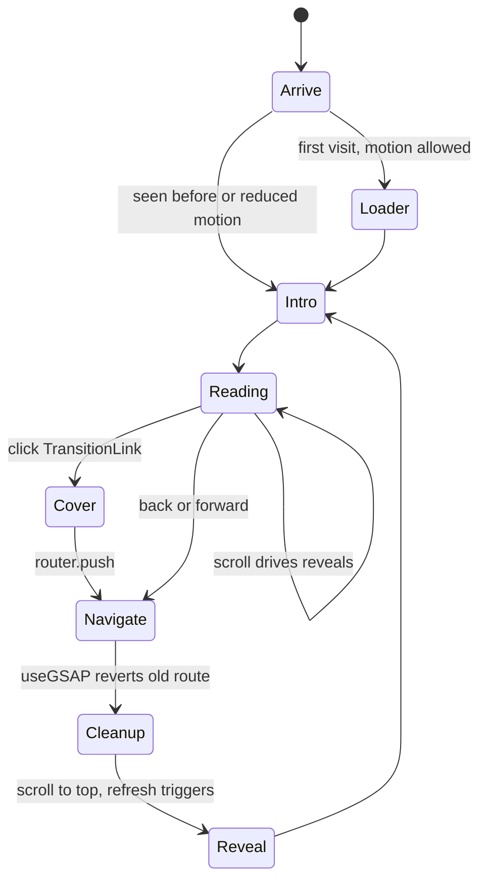
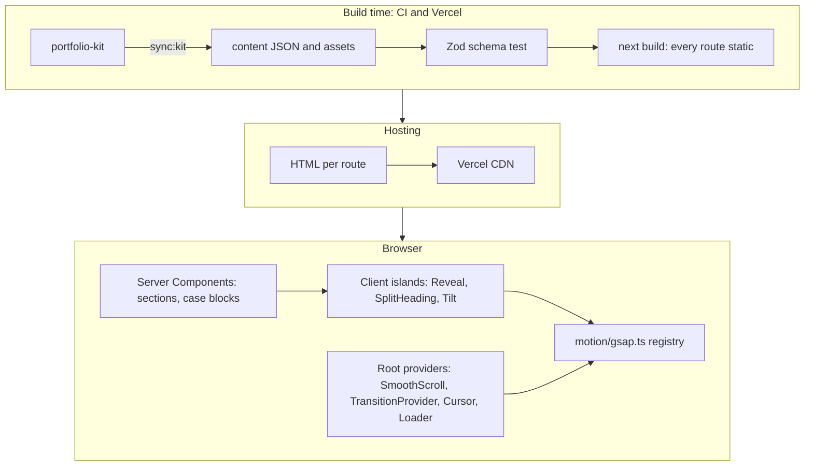
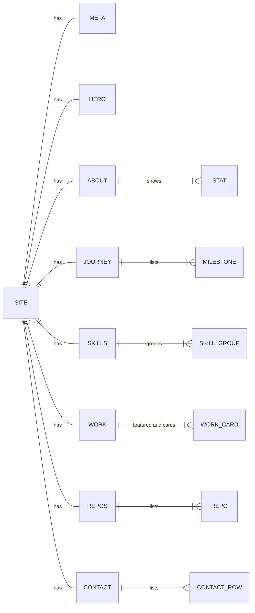
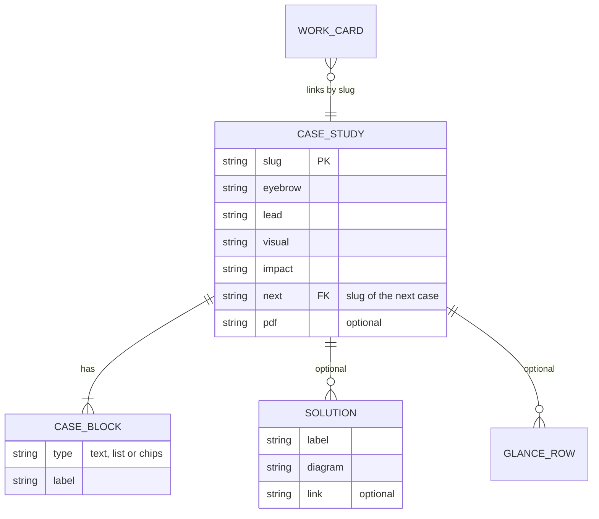
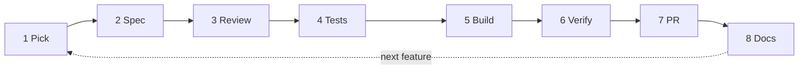

# Software Engineer Portfolio: Design Document

**Version** 1.0 · **Date** 8 Oct 2026 · **Author** Yosaphat Harwindra (Erwin) · **Status** Signed off by Erwin on 8 Oct 2026

Repository: `github.com/Blackpossum/software-engineer-portfolio` (to be created from the local repo `~/software_development/portofolio_dev`)

---

## 1. The Problem

Erwin's portfolio exists today as a Webflow site with a GSAP motion layer, live at `blacks-amazing-site-ff73a5.webflow.io`. It has a home page, five case studies (Rover, Fmlx Common UI, ESS, Promptomat, Parish room booking), a downloadable résumé and a motion layer of 28 named modules in `fx.js` (737 lines). It works for applications today, and it stays live (D-02).

For the roles Erwin applies to (remote React and full-stack positions, Europe first), it has three gaps:

1. **No React evidence.** The site is built in the Webflow Designer, so a hiring manager sees design and motion taste but no React code. His strongest work (Rover, Common UI and ESS at Formulatrix) is under NDA and has no public repository, so GitHub alone hides two years of production React.
2. **No ownership.** The free Webflow plan serves the site from a `webflow.io` subdomain. A custom domain needs a paid site plan (Basic, $15 per month billed yearly).
3. **Updates need the Designer.** Every copy change is a Designer session and a publish, with no review step and nothing that checks the change did not break a page.

The project is a React (Next.js) version of the same site, written by Erwin, that is itself the code sample: public, typed, tested and hosted for free.

> **Why this project (portfolio angle)**
>
> A portfolio site usually proves little, because it is static pages. This one carries a heavy motion layer written as plain DOM scripts, and moving it into React has three invisible hard parts:
>
> - **Motion that survives navigation.** The App Router has no "leave" hook. Tweens, ScrollTriggers and SplitText instances leak or duplicate across client navigations unless every effect is scoped and cleaned up. Webflow never had this problem, because every link was a full page load.
> - **Heavy motion with a fast first paint.** Content renders as Server Components and only thin client islands ship motion code, so Core Web Vitals stay in the "good" range on mobile.
> - **Motion that never hurts access.** Reduced motion is a hard gate, the custom cursor only appears with a fine pointer, keyboard focus stays visible, and every page reads fully with JavaScript off.
>
> The interview story: motion-heavy, but fast, accessible and leak-free, backed by tests rather than screenshots.

| Facts            |                                                                                                                                                                                                                                                                                                                     |
| ---------------- | ------------------------------------------------------------------------------------------------------------------------------------------------------------------------------------------------------------------------------------------------------------------------------------------------------------------- |
| Team             | Erwin: developer, writes every component and page. Claude Code: mentor for Erwin's code, implementer for chores (asset sync, content types, tests, CI, config, deploys) (D-06)                                                                                                                                      |
| Planned term     | 2 weeks target from sign-off, 3 weeks hard cap. Week 1 ends shippable (D-09)                                                                                                                                                                                                                                        |
| Key technologies | Next.js 16 App Router, React 19, TypeScript, GSAP 3.15 with `@gsap/react`, Lenis, CSS Modules                                                                                                                                                                                                                       |
| Full stack       | Static site generated at build time from JSON content; no backend, no database. Vitest (content schema), Playwright (Chromium, Firefox, WebKit, axe), Lighthouse CI. GitHub Actions for CI, Vercel Hobby for hosting (`vercel.app` address, custom domain later). pnpm, strict ESLint, Prettier, Husky, lint-staged |

---

## 2. Market and Differentiation (important)

**Research status.** Checked on 8 Oct 2026 against official pricing and documentation pages, plus news coverage of two shutdowns. Sources are listed at the end of this section. One statement used in the brainstorm is an assumption, not a fact: that a recruiter gives a portfolio "a minute or two". It shapes priorities but is not used as evidence.

### What people use today

| Alternative          | Example                                                                                  | Built for                                                   | Why it fails for Erwin                                                                                                                                                                                                                                     |
| -------------------- | ---------------------------------------------------------------------------------------- | ----------------------------------------------------------- | ---------------------------------------------------------------------------------------------------------------------------------------------------------------------------------------------------------------------------------------------------------- |
| No-code site builder | Webflow (the current site), Framer                                                       | Designers who want to ship visual sites fast                | Free plans only give a platform subdomain: Webflow Starter is "Webflow.io domain", and Framer requires a paid plan to connect a domain. A custom domain costs $15 per month (Webflow Basic, billed yearly) or $10 per month (Framer Basic). Shows no React |
| Starter template     | Vercel Portfolio Starter Kit (Next.js, MDX blog, Tailwind v4, OG images, Speed Insights) | Developers who want a blog plus portfolio with little setup | Proves the candidate can deploy a template, not engineer. Generic look, no room for case-study structure or custom motion                                                                                                                                  |
| Profile platform     | GitHub profile README, LinkedIn Featured, Peerlist                                       | Discovery and networking                                    | No space for a case study. Erwin's strongest work is under NDA with no public repo, so these hide it                                                                                                                                                       |
| Hosted profile tool  | Read.cv, Bento                                                                           | One-page profiles                                           | Fragile. Read.cv began winding down in Jan 2025 after Perplexity acquired it. Bento shut down on 13 Feb 2026 and its links now redirect to Linktree                                                                                                        |

### Comparison matrix

| Capability                                           | No-code builder    | Starter template              | Profile platform | This project             |
| ---------------------------------------------------- | ------------------ | ----------------------------- | ---------------- | ------------------------ |
| React code written by the candidate, open for review | No                 | Partly (template code)        | No               | Yes                      |
| Case studies for NDA work (architecture, no source)  | Yes (current site) | Possible, not included        | No               | Yes, five                |
| Custom motion system                                 | Yes                | No                            | No               | Yes, ported with cleanup |
| Custom domain without a monthly site fee             | No                 | Yes                           | No               | Yes, later (D-08)        |
| Content edited as data and checked in CI             | No                 | Partly (MDX, no schema check) | No               | Yes                      |
| Survives the platform changing or closing            | No                 | Yes                           | No               | Yes                      |
| Performance and accessibility measured               | No                 | Speed Insights included       | Not applicable   | Yes, in CI               |

### Positioning

For hiring managers and engineers screening remote React roles, this is a portfolio where **the site itself is the code sample**: a public, tested Next.js repo with a production-grade motion layer and five case studies. Unlike no-code sites, the code is open for review. Unlike starter templates, it is custom work that solves a real lifecycle problem. Unlike profile platforms, it explains NDA work through architecture and decisions, never source.

### Three differentiators

| #   | Differentiator                                                                                               | Objective |
| --- | ------------------------------------------------------------------------------------------------------------ | --------- |
| 1   | The site is the code sample: the hardest engineering (motion lifecycle) is visible in the repo and its tests | O2        |
| 2   | NDA work explained without code: all five case studies at parity, rendered from typed content                | O1        |
| 3   | Owned and measured: free hosting, content as validated data, Core Web Vitals and accessibility checked in CI | O3        |

### What we deliberately do not compete on

A blog or writing, a CMS or visual editing, a redesign or new visuals (parity only, D-05), SEO content marketing, analytics, i18n.

### Honest risks to the differentiation

- **Polished motion is cheap now.** Templates and AI site builders produce it quickly, so the difference only shows to someone who opens the repo or asks about it. Mitigation: the footer and README link the repo, and the README has a "How this site works" section with the three proofs.
- **Parity looks identical.** Someone who has seen the Webflow site sees nothing new. That is intended: the evidence is the engineering, not the visuals.
- **A worse React site is negative evidence.** If it is slower or buggier than the Webflow version, it hurts. Mitigation: the link is not sent until the ship checklist passes, and the Webflow site stays as the fallback (D-02).
- **Reviewers may never open the repo.** Mitigation: once measured, the CV and applications name the repo and one proof (for example, the leak test result).

**Sources**

- Webflow pricing: https://webflow.com/pricing
- Framer pricing: https://www.framer.com/pricing
- Vercel Hobby plan: https://vercel.com/docs/plans/hobby
- Vercel Portfolio Starter Kit: https://vercel.com/templates/next.js/portfolio-starter-kit
- TechCrunch, Perplexity acquires Read.cv (17 Jan 2025): https://techcrunch.com/2025/01/17/perplexity-acquires-read-cv-a-social-media-platform-for-professionals/
- AlternativeTo, Bento to shut down in 2026: https://alternativeto.net/news/2025/12/bento-to-shut-down-in-2026-as-linktree-takes-over-and-offers-migration-path/
- Peerlist: https://www.peerlist.io
- GitHub Docs, managing your profile README: https://docs.github.com/en/enterprise-server@3.15/account-and-profile/how-tos/profile-customization/managing-your-profile-readme

---

## 3. Objectives

**O1. Every page matches the Webflow site, rendered from typed content.**
Home, five case studies and a 404 are built from `site.json` and `cases.json` through a validated schema and styled with CSS Modules, and all 28 motion modules from `fx.js` are ported. Copy lives only in JSON; components never hardcode it.
_Done means:_ 7 of 7 routes signed off by Erwin against the reference screenshots at 1440, 991, 767 and 390 px (the signed-off screenshots then become Playwright baselines); 28 of 28 `fx.js` modules ported; the content schema test passes in CI.

**O2. Motion survives navigation without leaks.**
Every effect is scoped with `useGSAP` and reverted on unmount. The page transition owns the cover and reveal steps. Lenis and ScrollTrigger share one animation loop and refresh after fonts load and after each route reveal.
_Done means:_ after 10 home to case to back round trips, the live ScrollTrigger count equals the count after the first load, no overlay is left on screen, scroll is unlocked, and the console shows 0 hydration warnings. A Playwright test checks this in CI in Chromium, Firefox and WebKit.

**O3. Fast and accessible with motion on.**
Content is server-rendered HTML, motion ships only in client islands, and visitors who prefer reduced motion or use touch get a calm, complete site.
_Done means:_ Lighthouse mobile performance of 90 or more, with LCP of 2.5 s or less and CLS of 0.1 or less, on `/` and `/work/rover`; 0 serious or critical axe violations on all 7 routes; all content visible with `prefers-reduced-motion: reduce` and with JavaScript disabled. All checked in CI.

### Out of scope

- Blog or MDX (D-04), CMS, i18n, analytics dashboards, light mode, contact form
- Custom domain (later, D-08)
- Redesign, new sections or new content (D-05)
- The Project Artemis case study (already removed from the live site)
- Retiring the Webflow site (optional, D-02)
- Redirects from Webflow paths such as `/work-rover`: the Webflow site keeps its own address, so nothing links there

---

## 4. Users and Core Flows

### Users

> **Primary: hiring manager or recruiter**
> Screens candidates for remote React or full-stack roles (Europe first, then the US, Canada and Australia). Arrives from a CV, an application or a LinkedIn message. Wants to learn quickly who Erwin is, his level and proof of shipped work, then get the CV and a way to reach him. Mostly on desktop, sometimes on a phone. The visit fails if the page is slow, breaks on mobile, or animation hides the content.

<!-- card -->

> **Secondary: engineer in a technical screen**
> Opens the GitHub repo, reads the README and the motion code, may run it locally. Wants clean architecture, tests and reasons for decisions. Likely question: "Walk me through how your page transition cleans up."

<!-- card -->

> **Secondary: Erwin as maintainer**
> Edits copy and adds case studies by changing JSON. Wants CI to tell him when an edit breaks the content.

### User stories

| ID    | Story                                                                                                                                                          | Priority |
| ----- | -------------------------------------------------------------------------------------------------------------------------------------------------------------- | -------- |
| US-01 | As a recruiter, I see name, role, location and availability on the first screen                                                                                | Must     |
| US-02 | As a recruiter, I can open the CV in one click from the nav and from the contact section                                                                       | Must     |
| US-03 | As a recruiter, I can open each of the five case studies from the work section and move on to the next one                                                     | Must     |
| US-04 | As a recruiter on a phone, I can read every page without horizontal scrolling                                                                                  | Must     |
| US-05 | As a visitor who prefers reduced motion, I get all content with no animation                                                                                   | Must     |
| US-06 | As a keyboard user, I can reach every link with a visible focus ring; the mobile menu traps focus and closes on Esc                                            | Must     |
| US-07 | As a recruiter, I can reach Erwin by email, LinkedIn, GitHub or WhatsApp from the contact section                                                              | Must     |
| US-08 | As a visitor, a page change plays the wipe with the destination title, and back or forward never leaves a stuck overlay or locked scroll                       | Must     |
| US-09 | As a visitor, the site feels like the Webflow version: smooth scroll, reveals, count-up stats, hero and case intros                                            | Must     |
| US-10 | As an engineer, I find a README that explains the architecture and how to run the tests, and CI is green                                                       | Must     |
| US-11 | As Erwin, I change copy by editing JSON, and CI fails with a clear message if the edit breaks the schema                                                       | Must     |
| US-12 | As a visitor, I see the signature effects: first-visit loader, cursor and spotlight, journey pin, rover fleet on motion paths                                  | Should   |
| US-13 | As a recruiter sharing the link, the preview shows the right title, description and image                                                                      | Should   |
| US-14 | As a visitor, I can copy the email address and see a confirmation toast                                                                                        | Should   |
| US-15 | As a visitor, the polish effects are present: tilt, glare and glow, roll text, magnetic buttons, marquee, scramble labels, read scrub, nav hide and scroll-spy | Could    |

US-15 is "Could" only as build order. D-09 commits to full parity, so it is in scope within the 3-week cap.

### Page lifecycle with motion

With reduced motion, Loader, Cover and Reveal are skipped and content is visible at once. Back and forward skip the Cover step but still run Cleanup and Reveal, so the overlay can never stay on screen.

---

## 5. Architecture

Folder layout (from the build guide): `src/app` (layout, home, `work/[slug]`, not-found), `src/components` (`layout`, `home`, `case`, `ui`, `visuals`), `src/motion` (`gsap.ts`, providers, hooks), `src/content` (JSON, schema, loaders), `public` (images, illustrations, `resume.pdf`).

**Server and client rule.** A section component never imports GSAP. It renders markup with `data-*` hooks. A thin client wrapper or a hook in a client child adds the motion. If JavaScript fails, the page still reads correctly.

### The constraints shaped key decisions

| Constraint                                                                 | So                                                                                                                       | Rejected alternative                                                                           |
| -------------------------------------------------------------------------- | ------------------------------------------------------------------------------------------------------------------------ | ---------------------------------------------------------------------------------------------- |
| Content is static and already exported as JSON                             | Every route is generated at build time (`generateStaticParams`, `dynamicParams = false`) (D-10)                          | Rendering on each request: no dynamic data justifies it                                        |
| `fx.js` is GSAP, with 28 modules                                           | Keep GSAP, use `@gsap/react` and Lenis (D-11)                                                                            | Motion (Framer Motion): a rewrite of every effect, with no SplitText or MotionPath equivalent  |
| The App Router has no leave hook, and the wipe shows the destination title | A custom `TransitionProvider` and `TransitionLink` own cover, navigate and reveal (D-12)                                 | React `<ViewTransition>`: CSS-driven, so the dynamic title panel is hard. Kept as the fallback |
| CSS Modules hash class names                                               | Motion hooks target `data-*` attributes only (D-17, D-18)                                                                | Class selectors as in `fx.js`: they stop matching once classes are hashed                      |
| Recruiters may arrive on a phone and judge quickly                         | Server-rendered content, motion in client islands, Lighthouse in CI (D-10, O3)                                           | Whole pages marked `'use client'`: more JavaScript, slower first paint                         |
| Formulatrix work is under NDA                                              | The repo holds only what the live site already shows; the kit's `reference/` folder stays local and is gitignored (D-19) | Committing the whole kit                                                                       |
| Erwin works on Fedora, with no Safari                                      | Playwright's WebKit engine runs in CI as the Safari stand-in (D-21)                                                      | Manual Safari testing                                                                          |

### Quality attributes

| Attribute         | Target                                                                                    | Approach                                                                                                       |
| ----------------- | ----------------------------------------------------------------------------------------- | -------------------------------------------------------------------------------------------------------------- |
| Performance       | Lighthouse mobile 90 or more; LCP 2.5 s or less; CLS 0.1 or less on `/` and `/work/rover` | Static HTML, `next/font`, hero portrait as the priority image, motion in client islands, Lighthouse CI         |
| JavaScript budget | Per-route first-load budget set after the Stage 1 baseline (D-24)                         | Build output size check in CI                                                                                  |
| Motion lifecycle  | 0 leaked ScrollTriggers after 10 round trips; 0 hydration warnings                        | `useGSAP` scoping and cleanup, refresh after fonts and reveal, a test-only trigger count hook (D-25)           |
| Accessibility     | 0 serious or critical axe violations on 7 routes; full keyboard access                    | Reduced-motion gate, `(pointer: fine)` gate for the cursor, focus-visible rings, focus trap in the mobile menu |
| Resilience        | 7 of 7 routes readable with JavaScript off                                                | Content in server HTML; motion only adds                                                                       |
| Compatibility     | Green in Chromium, Firefox and WebKit at 1440, 991, 767 and 390 px                        | Playwright projects and viewports                                                                              |
| Maintainability   | Content edits are JSON only; 0 ESLint warnings; strict TypeScript                         | Zod schema test, strict lint config already in the repo                                                        |

---

## 6. Data Model

There is no database. The data model is the content in `src/content/site.json` and `src/content/cases.json`, validated by a Zod schema.

**Home content (`site.json`)**

**Case studies (`cases.json`)**

Current content: `site.json` has 10 sections (meta, nav, hero, about, journey, skills, work, repos, contact, footer); `cases.json` has 5 case studies (`rover`, `platform`, `ess`, `promptomat`, `parish`).

### Modelling rules

1. JSON is the only source of visible copy. Components never hardcode text.
2. Types come from the Zod schema through `z.infer`. App code imports types only, so Zod never ships to the browser (D-27).
3. `slug` is the ID. Work cards and `next` links reference slugs, and the schema test fails if a slug does not exist.
4. Every asset path (images, illustrations, PDFs) must exist under `public/`. The schema test checks it.
5. Optional case sections (`pdf`, `links`, `ndaNote` or `note`, `stats`, `solutions`, `figure`, `glance`, `reflection`) render only when present.
6. Section ids (`about`, `journey`, `skills`, `work`, `github`, `contact`) are fixed, because nav anchors depend on them.
7. External links open in a new tab with `rel="noopener"`.
8. No em dash in any content string. The schema test rejects them (D-23).

### Open questions

- Resolved: the 11 em dashes in `site.json` are replaced during the port (D-23).
- The empty `placeholders` key in `site.json` is a kit leftover. Proposal: drop it from the schema.

---

## 7. Design System

### Principles

1. **Parity first.** The Webflow design is the spec, and the reference screenshots are the visual target.
2. **Black canvas, one accent.** Lime `#CCFF33` is used only for actions, progress and highlights.
3. **Motion explains, never blocks.** Content is readable before, during and without animation.
4. **Tokens over values.** Components use CSS variables, never raw hex values.
5. **Style and motion stay apart.** CSS Modules style the markup, and `data-*` attributes drive motion (D-18).

### Color tokens (WCAG contrast computed)

| Token                              | Value                       | Used for                                | Contrast                                                          |
| ---------------------------------- | --------------------------- | --------------------------------------- | ----------------------------------------------------------------- |
| `--bg--base`                       | #000000                     | Page background                         | Base for the ratios below                                         |
| `--bg--surface`                    | #0A0A0A                     | Cards, loader and wipe panels           |                                                                   |
| `--bg--raised`                     | #1A1A1A                     | Chips, raised cards                     |                                                                   |
| `--border`                         | #2E2E2E                     | Dividers, card outlines                 | 1.55:1 on base: decorative only, never the only cue for a control |
| `--accent`                         | #CCFF33                     | CTA fill, progress bar, highlights      | 17.92:1 as text on base; black text on accent 17.92:1             |
| `--accent--hover`                  | #D4FF66                     | Button hover                            | Black text 18.30:1                                                |
| `--text--primary`                  | #EDEDED                     | Headings and body                       | 17.94:1 on base, 14.87:1 on raised                                |
| `--text--secondary`                | #D4D4D4                     | Lead paragraphs                         | 14.17:1 on base, 13.36:1 on surface                               |
| `--text--muted`                    | #A1A1A1                     | Labels, meta, captions                  | 8.13:1 on base, 7.66:1 on surface, 6.74:1 on raised               |
| `--success` / `--info` / `--error` | #22C55E / #38BDF8 / #F87171 | Status dot, rover zones, route conflict | 9.22:1, 9.80:1 and 7.59:1 on base                                 |

Every text pairing passes WCAG AA, and all but the raised muted pairing pass AAA (7:1).

### Type scale

Inter for text, JetBrains Mono for code and labels, both loaded with `next/font` under the variable names the CSS already uses.

| Style                    | Desktop | 991 px | 767 px | 479 px | Weight, line height        |
| ------------------------ | ------- | ------ | ------ | ------ | -------------------------- |
| `heading-xl` (hero)      | 76      | 60     | 46     | 39     | 700, 1.06                  |
| `heading-case`           | 72      | 56     | 40     | 34     | 700, 1.06                  |
| `heading-contact`        | 68      | 54     | 40     | 34     | 700, 1.08                  |
| `heading-l` (sections)   | 48      | 40     | 32     | 32     | 600, 1.15                  |
| `stat-number`            | 44      |        |        |        | 700, 1                     |
| `case-lead`              | 20      |        |        |        | 1.65                       |
| `case-text`              | 19      |        |        |        | 1.7                        |
| Buttons                  | 16      |        |        |        | 600, 1.2                   |
| `nav-link`               | 15      |        |        |        | 500                        |
| `chip`                   | 14      |        |        |        | 500, 1.3                   |
| `eyebrow` / `case-label` | 13 / 12 |        |        |        | 500, letter spacing 0.14em |
| Body base                | 14      |        |        |        | line height 20 px          |

Values are in px, taken from `styles/site.css`. Empty cells keep the desktop value.

### Spacing, radius, motion

- **Layout:** container max width 1248 px with 24 px side padding; sections have 128 px top padding.
- **Gaps:** mostly 24, 20, 48, 32 and 16 px; card padding 28 to 32 px.
- **Radius:** 999 px for pills and buttons, 18 to 24 px for cards, 10 to 14 px for small elements, 50% for dots and avatars.
- **Breakpoints:** 991, 767 and 479 px, as `max-width` queries in that order.
- **Motion:**
  - CSS transitions run 200 to 300 ms on color, border and transform, using `--fx-ease: cubic-bezier(.16, 1, .3, 1)`.
  - GSAP eases: `expo.out`, `expo.inOut`, `power3.out`, `power4.out`, `back.out(3)`.
  - Reduced motion turns every effect off.

### Component inventory and states

| Component                        | States                                                                                                                                                   |
| -------------------------------- | -------------------------------------------------------------------------------------------------------------------------------------------------------- |
| Button (primary, secondary, nav) | Default, hover (accent hover fill or border and text change), focus-visible ring, pressed; week 2: magnetic pull (fine pointer only), roll text on hover |
| NavLink                          | Default, hover, current section (scroll-spy underline), focus-visible                                                                                    |
| Nav                              | Visible at the top; hidden on scroll down and shown on scroll up (week 2); mobile menu closed or open (focus trapped, Esc closes, page scroll locked)    |
| Chip                             | Default, primary (accent), revealed (staggered)                                                                                                          |
| StatusPill                       | Default with a live success dot                                                                                                                          |
| StatCard                         | Start value, counting, final value; reduced motion shows the final value                                                                                 |
| WorkFeatured, WorkCard           | Default, hover (tilt, glare, glow with a fine pointer), focus-visible, visual loop playing or paused off-screen                                          |
| RepoCard                         | Default, hover (glow, arrow nudge), focus-visible                                                                                                        |
| ContactCard, CopyEmail           | Idle, copied (toast shown), copy failed (falls back to a `mailto:` link)                                                                                 |
| Toast                            | Hidden, shown, hiding                                                                                                                                    |
| Cursor                           | Off (touch, coarse pointer or reduced motion), default disc, hug (links and buttons), I-beam (text), card (dot and lift)                                 |
| Loader                           | Skipped (seen this session, or reduced motion), counting, exiting                                                                                        |
| Wipe                             | Idle, covering (lime panel, black panel, destination title), revealing                                                                                   |
| ScrollProgress                   | 0 to 100% scrubbed; hidden with reduced motion                                                                                                           |
| Journey                          | Desktop pinned with scrubbed milestones; mobile vertical progress; reduced motion as a static list                                                       |
| CaseBlock list                   | Hidden, then items pop in; reduced motion shows them at once                                                                                             |
| RoverFleet, mini visuals         | Moving on paths, tooltip on hover or focus, paused off-screen; reduced motion static                                                                     |
| Images                           | Space reserved by aspect ratio (no layout shift), loaded                                                                                                 |

---

## 8. Decision Log

Rule: a decision changes in this log first, then in code.

| ID   | Decision                                                                                                                                                    | Alternatives                                                               | Why                                                                                                         | Status             |
| ---- | ----------------------------------------------------------------------------------------------------------------------------------------------------------- | -------------------------------------------------------------------------- | ----------------------------------------------------------------------------------------------------------- | ------------------ |
| D-01 | Name the GitHub repo and package `software-engineer-portfolio`                                                                                              | Keep `portofolio_dev`; `software_engineer_portofolio`                      | Credibility: correct spelling, and hyphens are the GitHub convention. The local folder name does not matter | Accepted           |
| D-02 | The Webflow site stays live in parallel. Erwin sends the React link when a role wants React evidence; retiring Webflow is optional                          | Retire Webflow at launch                                                   | Zero-risk fallback while the React version matures                                                          | Accepted           |
| D-03 | Ship v1 in 1 week                                                                                                                                           | 2 weeks                                                                    | First timebox                                                                                               | Superseded by D-09 |
| D-04 | No blog in v1                                                                                                                                               | MDX blog, as in the starter kit                                            | Does not fit the timebox, and an empty blog looks worse than none                                           | Accepted           |
| D-05 | v1 is a faithful copy of the Webflow site, with no new features                                                                                             | Redesign                                                                   | Content and design are already validated; the evidence is the engineering                                   | Accepted           |
| D-06 | Mixed mode: Erwin writes components and pages; Claude Code mentors and does the chores                                                                      | Claude Code writes everything; Erwin writes everything                     | Only code Erwin writes and can explain counts as evidence, and chores would eat the timebox                 | Accepted           |
| D-07 | Help ladder (explain, hint, skeleton, pair) with a 30-minute rule; every spec opens with a Concepts box                                                     | Ad-hoc help                                                                | Getting stuck on new APIs is the top schedule risk                                                          | Accepted           |
| D-08 | Custom domain later                                                                                                                                         | Buy one now                                                                | Not needed to prove the work; `vercel.app` is fine for v1                                                   | Accepted           |
| D-09 | Full parity, targeted at 2 weeks with a 3-week hard cap. Week 1 ends shippable (v1 scope on `vercel.app`)                                                   | 1 week with effects cut                                                    | Erwin prefers extending the time to cutting effects                                                         | Accepted           |
| D-10 | Next 16 App Router, every route static                                                                                                                      | Rendering per request                                                      | No dynamic data; fastest first paint, free hosting                                                          | Accepted           |
| D-11 | GSAP, `@gsap/react` and Lenis                                                                                                                               | Motion (Framer Motion)                                                     | `fx.js` is GSAP; switching means rewriting all 28 modules                                                   | Accepted           |
| D-12 | Custom `TransitionProvider` and `TransitionLink`, with `<ViewTransition>` as the fallback                                                                   | `<ViewTransition>` first                                                   | The wipe shows the destination title; owning leave and enter is the hard problem to prove                   | Accepted           |
| D-13 | Content as JSON, typed, plus a schema check in tests                                                                                                        | MDX, a CMS                                                                 | Content is already exported; a broken edit should fail CI, not production                                   | Accepted           |
| D-14 | Playwright for end-to-end checks (smoke, back and forward, leak count, axe, reduced motion); Vitest for the content schema                                  | Component unit tests                                                       | The proof points are browser behaviour                                                                      | Accepted           |
| D-15 | GitHub Actions on every PR (lint, typecheck, Vitest, build, Playwright, Lighthouse) and a Vercel preview per PR                                             | Manual checks                                                              | Every acceptance check must pass in CI                                                                      | Accepted           |
| D-16 | Keep pnpm, strict ESLint, Prettier, Husky and lint-staged                                                                                                   | None                                                                       | Already set up in the repo                                                                                  | Accepted           |
| D-17 | CSS Modules per component                                                                                                                                   | Global `site.css`; Tailwind                                                | Shows React structure; Tailwind would mean rewriting 2,273 lines of CSS                                     | Accepted           |
| D-18 | Motion hooks target `data-*` attributes only                                                                                                                | Class selectors                                                            | CSS Modules hash class names; keeps style and motion independent                                            | Accepted           |
| D-19 | The repo holds only what the live site already shows; the kit's `reference/` folder stays local and is gitignored                                           | Commit the whole kit                                                       | NDA safety and repo size                                                                                    | Accepted           |
| D-20 | Claude Code reads the docs bundled in `node_modules/next/dist/docs` before writing Next-specific code                                                       | Rely on training data                                                      | Next 16 changed APIs; the repo's AGENTS.md already asks for this                                            | Accepted           |
| D-21 | Playwright's WebKit engine runs in CI as the Safari stand-in                                                                                                | Manual Safari checks                                                       | Erwin works on Fedora, with no Safari                                                                       | Accepted           |
| D-22 | After v1, both sites stay full showcases: every content change goes to the JSON and to the Webflow site in the same session, and `progress.md` records both | JSON first with Webflow critical fixes only; Webflow leads; freeze Webflow | Webflow stays the showcase for Webflow roles and React for React roles (D-02), so neither may go stale      | Accepted           |
| D-23 | Replace all 11 em dashes in `site.json` during the port, and add a schema rule that rejects them                                                            | Keep exact parity                                                          | Erwin's writing rule; a one-time content fix                                                                | Accepted           |
| D-24 | Set a per-route first-load JavaScript budget from the Stage 1 baseline, and fail CI above it                                                                | A fixed number now                                                         | No baseline exists yet, so a number now would be invented                                                   | Accepted           |
| D-25 | Expose the live ScrollTrigger count through a test-only window hook, enabled only in the end-to-end build                                                   | Count DOM side effects instead                                             | The leak test needs a direct, reliable number                                                               | Accepted           |
| D-26 | If 3 weeks is not enough, re-plan with Erwin before cutting anything                                                                                        | Cut list agreed now                                                        | Erwin chose time over cuts                                                                                  | Accepted           |
| D-27 | Zod as the schema library, with types inferred through `z.infer` and imported as types only                                                                 | Hand-written TS interfaces plus a custom check                             | One source for types and validation, at no runtime cost                                                     | Accepted           |

---

## 9. Delivery Plan

Days count from the first working day after sign-off. Week 1 is Days 1 to 7, week 2 is Days 8 to 14, and week 3 (Days 15 to 21) is buffer only: no new scope enters it.

**Stage 1: Foundation (Days 1 to 2)**

- **Scope:** F-01 to F-03.
  - Repo rename and remote, kit sync, content schema and loaders.
  - CI pipeline and Vercel previews.
  - Tokens, fonts, base reset and shared UI.
  - Layout shell (Nav, Footer, Container).
- **Acceptance check (CI):**
  - The schema test passes, and fails on a broken fixture.
  - Smoke test: `/` returns 200 with no console errors in three engines.
  - Nav anchors exist, and below 991 px the mobile menu opens, traps focus and closes on Esc.
  - A Vercel preview is posted to the PR.

**Stage 2: Static parity (Days 3 to 5)**

- **Scope:** F-04 to F-08.
  - Home (7 sections), the case template for 5 slugs, and the 404.
  - Metadata, Open Graph image, sitemap and robots.
- **Acceptance check (CI):**
  - All 7 routes load in three engines with no console errors.
  - The `next` links loop through all five cases back to Rover.
  - 0 serious or critical axe violations.
  - No horizontal overflow at 390 px, and all content visible with JavaScript disabled.
  - Erwin signs off each route against the reference screenshots, and the signed-off screenshots (taken with reduced motion) become Playwright baselines.

**Stage 3: Motion foundation and navigation (Days 6 to 7), the end of week 1**

- **Scope:** F-09 and F-10.
  - GSAP registry and SmoothScroll on one loop, the reduced-motion gate.
  - Reveal, count-up, progress bar.
  - Page transition, hero and case intros.
  - Leak test and Lighthouse CI.
- **Acceptance check (CI):**
  - Leak test: 10 round trips with a constant trigger count, no stuck overlay, scroll unlocked and at the top after navigating.
  - 0 hydration warnings.
  - Reduced-motion test: everything visible, nothing transformed.
  - Lighthouse mobile 90 or more on `/` and `/work/rover`.
  - **Production deploy on `vercel.app` (v1).**

**Stage 4: Signature effects (Days 8 to 10)**

- **Scope:** F-11 to F-15.
  - Loader.
  - Cursor and spotlight.
  - Split headings, scramble labels and read scrub.
  - Journey pin.
  - Rover fleet and minis.
- **Acceptance check (CI):**
  - The loader shows once per tab session and never with reduced motion.
  - No cursor element under touch emulation or reduced motion.
  - The journey pin causes no layout shift (CLS stays at 0.1 or less).
  - Rover tooltips are reachable by keyboard.
  - The leak test, axe and Lighthouse stay green.

**Stage 5: Polish and ship (Days 11 to 14)**

- **Scope:** F-16 to F-19.
  - Card interactions and roll text, magnetic buttons, marquee, hero scroll-out and case parallax.
  - Nav hide, scroll-spy, copy email and toast.
  - README "How this site works", ship checklist, production deploy.
- **Acceptance check (CI):**
  - All suites green in three engines.
  - The copy-email test shows the toast.
  - The scroll-spy test marks the current section.
  - 28 of 28 `fx.js` modules ticked in `progress.md`.
  - Ship checklist complete.

### Metrics

| Metric                                     | Target                              | How measured                                           | Actual |
| ------------------------------------------ | ----------------------------------- | ------------------------------------------------------ | ------ |
| Routes at visual parity                    | 7 of 7                              | Erwin's sign-off, then Playwright screenshot baselines |        |
| `fx.js` modules ported                     | 28 of 28                            | Checklist in `progress.md`                             |        |
| ScrollTriggers leaked after 10 round trips | 0                                   | Playwright leak test (D-25)                            |        |
| Hydration warnings                         | 0                                   | Playwright console listener on all routes              |        |
| Lighthouse mobile performance              | 90 or more on `/` and `/work/rover` | Lighthouse CI                                          |        |
| LCP / CLS (lab, mobile)                    | 2.5 s or less / 0.1 or less         | Lighthouse CI                                          |        |
| Serious or critical axe violations         | 0 on 7 routes                       | `@axe-core/playwright`                                 |        |
| Routes readable with JavaScript off        | 7 of 7                              | Playwright with JavaScript disabled                    |        |
| Browser engines green in CI                | 3 of 3                              | Playwright projects                                    |        |
| First-load JavaScript per route            | Budget from Stage 1 (D-24)          | Build output check in CI                               |        |
| Calendar time to full parity               | 14 days or less (cap 21)            | Dates in `progress.md`                                 |        |
| Help-ladder pair sessions (rung 4)         | Tracked, no target                  | Log in `progress.md`                                   |        |

---

## 10. Feature Development Workflow

### The feature loop

1. **Pick** the next feature: `progress.md` names it.
2. **Write the spec.** Claude Code drafts it from the template below, including the Concepts box.
3. **Erwin reviews** and approves the spec. No code before approval.
4. **Tests first.** Claude Code writes the failing Playwright or Vitest tests for the acceptance criteria (a chore).
5. **Implement in small commits.** Erwin writes the components and pages, and Claude Code mentors (help ladder, D-07). Claude Code implements chore tasks.
6. **Verify:** tests green locally, compared with the reference screenshot at the four widths.
7. **PR and checklist.** The PR description ends with Erwin's "How it works" teach-back in his own words. Claude Code reviews and asks 2 questions.
8. **Update docs:** `progress.md` (what changed, weak spots, next step) and `decisions.md` if anything changed.

### Rules

- One feature per branch and PR: `feat/F-04-hero-about`, `chore/F-01-foundation`.
- No code before an approved spec.
- Conventional commits, enforced by a commit-msg hook.
- Claude Code never writes component or page code unless Erwin asks for rung 4, and every rung 4 assist is logged in `progress.md`.
- Stuck for 30 minutes on one thing means moving up one rung of the help ladder.
- No em dash in code comments, docs, commit messages or PR text.

### Feature backlog

| ID   | Feature                                                                                                              | Stories      | Stage | Depends on   | Size | `fx.js` modules                                  |
| ---- | -------------------------------------------------------------------------------------------------------------------- | ------------ | ----- | ------------ | ---- | ------------------------------------------------ |
| F-01 | Repo foundation: rename and remote, kit sync, content schema and loaders, CI, Vercel                                 | US-10, US-11 | 1     | None         | M    |                                                  |
| F-02 | Tokens, fonts, base reset, CSS Modules conventions, shared UI (Button, Chip, Eyebrow, SectionHead, StatusPill, Card) | US-04, US-06 | 1     | F-01         | M    |                                                  |
| F-03 | Layout shell: Nav with mobile menu, Footer, Container                                                                | US-02, US-06 | 1     | F-02         | M    |                                                  |
| F-04 | Home: Hero, About and StatCard                                                                                       | US-01        | 2     | F-03         | M    |                                                  |
| F-05 | Home: Journey and Skills                                                                                             | US-01        | 2     | F-03         | M    |                                                  |
| F-06 | Home: Work, Repos and Contact                                                                                        | US-03, US-07 | 2     | F-03         | M    |                                                  |
| F-07 | Case template `/work/[slug]`, all optional sections, 404                                                             | US-03, US-04 | 2     | F-03         | L    |                                                  |
| F-08 | Metadata, Open Graph image, sitemap, robots                                                                          | US-13        | 2     | F-07         | S    |                                                  |
| F-09 | Motion foundation: registry, SmoothScroll, reduced-motion gate, Reveal, count-up, progress bar, Lighthouse CI        | US-05, US-09 | 3     | F-04 to F-07 | M    | lenis, progress, reveals                         |
| F-10 | Page transition, hero and case intros, leak test                                                                     | US-08, US-09 | 3     | F-09         | L    | links, enter, heroIntro, caseIntro               |
| F-11 | First-visit loader with no flash                                                                                     | US-12        | 4     | F-10         | S    | loader                                           |
| F-12 | Cursor and spotlight                                                                                                 | US-12        | 4     | F-09         | M    | cursor, spotlight                                |
| F-13 | Split headings, scramble labels, read scrub                                                                          | US-15        | 4     | F-09         | M    | split, scramble, read                            |
| F-14 | Journey pin and mobile progress                                                                                      | US-12        | 4     | F-09         | M    | journey                                          |
| F-15 | Rover fleet motion paths and tooltips, mini visuals                                                                  | US-12        | 4     | F-09         | M    | rover, minis                                     |
| F-16 | Card tilt, glare and glow, roll text, magnetic buttons, "move." jiggle                                               | US-15        | 5     | F-09         | M    | interactions, roll, magnetic, magneticBase, move |
| F-17 | Marquee, hero scroll-out, work visual scale, case parallax and next-title fill                                       | US-15        | 5     | F-09         | M    | marquee, heroOut, work, case                     |
| F-18 | Nav hide, scroll-spy, copy email and toast                                                                           | US-14, US-15 | 5     | F-03, F-09   | S    | nav, spy, copy                                   |
| F-19 | Ship: README "How this site works", ship checklist, production deploy                                                | US-10        | 5     | All          | S    |                                                  |

The `fx.js` column covers all 28 modules exactly once.

### Feature spec template

Every spec in `docs/features/F-xx-name.md` has a Concepts box followed by ten parts:

0. **Concepts box:** what is new in this feature, a docs link for each concept, 2 to 3 lines on why it matters.
1. **Goal:** one paragraph.
2. **Acceptance criteria:** numbered, written as Given / When / Then.
3. **API contract:** component props, hook signatures and the content types read. This is a static site, so this replaces a REST contract.
4. **Data changes:** JSON, schema or asset changes.
5. **Frontend states:** every visual and motion state, including reduced motion.
6. **Edge cases.**
7. **Test plan:** each test mapped to an acceptance criterion.
8. **Task breakdown:** one commit per line, with an owner (Erwin or Claude Code).
9. **Out of scope.**
10. **Decisions referenced.**

### Worked example: F-01 Repo foundation

**0. Concepts box**

- **Zod and `z.infer`:** one schema gives both runtime validation and TypeScript types. https://zod.dev
- **Playwright projects:** one config runs the same tests in Chromium, Firefox and WebKit. https://playwright.dev/docs/test-projects
- **GitHub Actions:** a workflow file runs the checks on every pull request. https://docs.github.com/actions
- **Vercel Git integration:** every PR gets its own preview URL. https://vercel.com/docs/git
- **Next 16 file conventions:** read the docs bundled in `node_modules/next/dist/docs` before touching `app/` (D-20).

**1. Goal.** A renamed, connected repository where the current kit content and assets live inside the app, typed and validated. Every PR runs the full check pipeline and gets a Vercel preview. No visual work yet.

**2. Acceptance criteria**

1. Given the GitHub account Blackpossum, when the repo list is opened, then `software-engineer-portfolio` exists with `main` pushed and the package name matches.
2. Given the kit at `~/Downloads/portfolio-kit`, when `pnpm sync:kit` runs, then `public/images`, `public/illustrations`, `public/resume.pdf` and `src/content/*.json` match the kit, the four stale Artemis-era files are removed, and nothing from `reference/` is copied.
3. Given valid content, when `pnpm test:unit` runs, then the schema test passes. Given a fixture with an unknown `next` slug, a missing asset file or an em dash, then it fails with a message naming the field.
4. Given a pull request, when CI runs, then lint, typecheck, unit tests, build and the Playwright smoke test (three engines) all run and are required to merge.
5. Given the smoke test, when it loads `/`, then the response is 200 and the console has no errors.
6. Given a pull request, when Vercel builds it, then a preview URL appears on the PR.
7. Given the repository, when CI lists tracked files, then no path under `reference/` is tracked.

**3. API contract**

- `src/content/schema.ts` exports the `SiteSchema` and `CaseStudySchema` Zod schemas, and the `Site`, `CaseStudy` and `CaseBlock` types.
- `src/content/index.ts` exports:
  - `getSite(): Site`
  - `getCases(): CaseStudy[]`
  - `getCase(slug: string): CaseStudy | undefined`
- `package.json` scripts: `sync:kit`, `typecheck`, `test:unit`, `test:e2e`, `lint`, `build`.

**4. Data changes**

- Add `src/content/site.json` and `src/content/cases.json` from the kit.
- Add `public/resume.pdf`.
- Replace `public/illustrations` (add 23 files; remove `card-arch.svg`, `card-code.svg`, `card-streak.svg` and `case-artemis.svg`).
- Refresh `public/images`.
- Bring `src/styles/tokens.css` and `src/styles/site.css` up to the current kit. `site.css` stays as a porting reference only and is not imported.

**5. Frontend states.** Only a placeholder home page that replaces the create-next-app page and its leftover Tailwind classes.

**6. Edge cases**

- Kit path missing: the sync script exits with a clear message and changes nothing.
- Paths are case-sensitive on Vercel's Linux builders.
- Em dashes: the 11 in `site.json` are replaced in F-01 and the schema rejects new ones (D-23). Erwin reviews the new wording, since it is his copy.
- The `placeholders` key is dropped from the schema.
- `sharp` builds are disabled in `pnpm-workspace.yaml`, so check that `next/image` still works on Vercel.

**7. Test plan**

| Test                                                                                              | Criteria |
| ------------------------------------------------------------------------------------------------- | -------- |
| `content.test.ts`: valid content passes; mutated fixtures (bad slug, missing asset, em dash) fail | AC3      |
| `smoke.spec.ts`: `/` returns 200 with no console errors, in three engines                         | AC4, AC5 |
| CI step that fails if `git ls-files` lists `reference/`                                           | AC7      |
| Sync script dry run, then a diff against the kit                                                  | AC2      |
| Manual checks: repo, package name, Vercel preview on the first PR                                 | AC1, AC6 |

**8. Task breakdown (one commit each)**

1. `chore: rename package to software-engineer-portfolio` (Claude Code). Erwin creates the GitHub repo and adds the remote.
2. `chore: replace default page with placeholder` (Claude Code)
3. `chore: add kit sync script and sync content, assets and resume` (Claude Code)
4. `test: add failing content schema test` (Claude Code)
5. `feat: add zod content schema and typed loaders` (Claude Code)
6. `fix(content): replace em dashes in site.json` (Claude Code; Erwin approves the wording)
7. `test: add Playwright with three browser projects and smoke test` (Claude Code)
8. `ci: add GitHub Actions workflow for lint, typecheck, unit, build and e2e` (Claude Code)
9. `chore: add commitlint commit-msg hook` (Claude Code)
10. `docs: README with run and test commands` (Claude Code)
11. Connect the Vercel project in the dashboard (Erwin; no commit)

**9. Out of scope.** Any visual component, tokens and fonts in use (F-02), Lighthouse CI (F-09), custom domain.

**10. Decisions referenced.** D-01, D-06, D-13, D-14, D-15, D-16, D-19, D-20, D-23, D-27.

### Definition of Done

- [ ] Every acceptance criterion passes in CI (or is checked manually where the spec says so)
- [ ] Lint, typecheck and build pass with 0 warnings
- [ ] UI features: matches the reference screenshot at 1440, 991, 767 and 390 px; keyboard reachable; works with reduced motion
- [ ] No console errors or hydration warnings
- [ ] Erwin can explain every line he wrote; rung 4 assists are logged
- [ ] The PR has the teach-back "How it works" section
- [ ] `progress.md` updated, and `decisions.md` too if anything changed
- [ ] Content changed? The Webflow site got the same change in this session (D-22)
- [ ] Conventional commits, and no em dash anywhere

---

## 11. Risks and Expected Change

| Risk                                                        | Impact                                    | Mitigation                                                                                                                    |
| ----------------------------------------------------------- | ----------------------------------------- | ----------------------------------------------------------------------------------------------------------------------------- |
| Erwin gets stuck on new APIs (App Router, `useGSAP`, Lenis) | High: a lost day is 7% of a 2-week target | Help ladder, 30-minute rule, a Concepts box in every spec, working snippets in the build guide (D-07)                         |
| The timebox slips because of applications and interviews    | High                                      | Week 1 ends shippable; `progress.md` is updated every session; week 3 is buffer only; re-plan before cutting (D-09, D-26)     |
| Next 16 differs from what Claude was trained on             | Medium                                    | Read the bundled docs first (D-20)                                                                                            |
| Hydration errors from SplitText and roll text               | Medium                                    | DOM-rewriting effects only inside `useGSAP`, reverted in cleanup, never on the server; Playwright fails on hydration warnings |
| ScrollTrigger leaks or wrong positions after navigating     | High: this is proof point O2              | `useGSAP` cleanup, refresh after fonts and each route reveal, leak test in CI (D-25)                                          |
| Stale assets: the repo has the 3 Oct kit                    | Medium                                    | F-01 syncs from the current kit                                                                                               |
| NDA: the public repo leaks more than the site shows         | High                                      | The repo holds only what the live site shows; `reference/` stays local (D-19)                                                 |
| Content drift between Webflow and React                     | Medium: two live sites                    | Every content change updates both in the same session, and the Definition of Done checks it (D-22)                            |
| Heavy motion hurts Core Web Vitals                          | Medium                                    | Client islands, JavaScript budget (D-24), Lighthouse CI                                                                       |
| Safari-only bugs (`background-clip: text`, `@property`)     | Medium                                    | WebKit in CI (D-21), `@supports` guards from `motion.css`                                                                     |
| Vercel Hobby is non-commercial                              | Low                                       | Fine for a personal portfolio; move to Pro or another host if the site ever sells services                                    |

### Before and after at a glance (planned)

|                      | Before (Webflow)                                          | After (React, planned)                                   |
| -------------------- | --------------------------------------------------------- | -------------------------------------------------------- |
| Public code          | None                                                      | Public repo with tests and CI                            |
| Address              | `webflow.io` subdomain; a custom domain needs a paid plan | `vercel.app` now, own domain later; hosting free         |
| Content edits        | Designer session and publish                              | JSON edit and PR, validated in CI                        |
| Automated tests      | 0                                                         | Content schema, end-to-end in 3 engines, axe, Lighthouse |
| Navigation           | Full page load on every link                              | Client navigation with a wipe, measured to be leak-free  |
| Accessibility checks | Manual                                                    | axe in CI on 7 routes                                    |
| Performance          | Not measured                                              | Lighthouse mobile 90 or more, measured in CI             |

---

## 12. Handoff to Claude Code

### Repo files

| File                                    | Purpose                                                                                                                                                    |
| --------------------------------------- | ---------------------------------------------------------------------------------------------------------------------------------------------------------- |
| `docs/design.md` and `docs/design.pdf`  | This document, the source of truth                                                                                                                         |
| `docs/decisions.md`                     | The decision log only; decisions change here first                                                                                                         |
| `docs/brainstorm-notes.md`              | Raw brainstorm summary, including rejected ideas and why                                                                                                   |
| `docs/features/F-01-repo-foundation.md` | The worked spec; later specs land in this folder                                                                                                           |
| `docs/progress.md`                      | Session log. Starts with "next feature = F-01" and the 28-module checklist                                                                                 |
| `CLAUDE.md`                             | Order of authority, session ritual, mentor and implementer roles, help ladder, commands, writing rules. It keeps the `@AGENTS.md` import that Next manages |

### Order of authority

1. Erwin's current message
2. `docs/decisions.md`, Accepted rows
3. `docs/design.md`
4. Existing code conventions
5. Claude Code's own judgement, only for details nothing above covers, and logged in `progress.md`

### Session ritual

1. Read `CLAUDE.md`, `docs/design.md`, `docs/decisions.md` and `docs/progress.md` before any code.
2. Restate in 5 lines: the current stage, its acceptance check, the feature in progress, the decisions that apply, and Erwin's weak spots from the last session. Wait for Erwin to confirm.
3. Open with the feature's Concepts box (mentor brief).
4. Work on one feature per session, following the feature loop. Help ladder on request; the 30-minute rule applies.
5. If something is not in the docs, ask; do not decide.
6. End by appending to `progress.md`: what changed, the teach-back result and 2 questions, weak spots, new decision rows, next step.

### Design doc to case study mapping (for Phase 6)

| Design doc section                  | Case study section                        |
| ----------------------------------- | ----------------------------------------- |
| 1. The Problem                      | The Challenge                             |
| 2. Market and Differentiation       | Why it matters                            |
| 3. Objectives                       | Objectives, with real outcomes            |
| 9. Delivery Plan (stages)           | Solution and outcome by stage             |
| 8. Decision Log (best 3 rows)       | The constraints that shaped key decisions |
| 9. Metrics (Actual column)          | Measured results                          |
| 11. Before and after                | Before and after at a glance, measured    |
| 11. Risks, plus `progress.md` notes | What made this hard                       |
